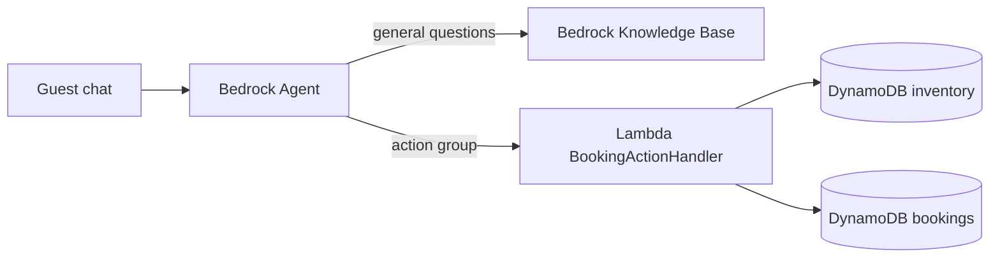
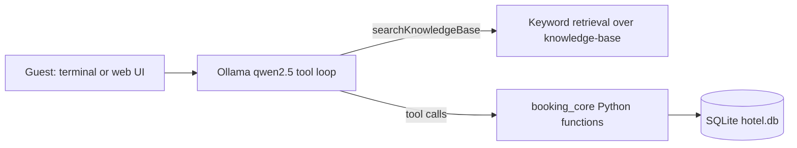

# AI-Driven Hotel Booking Assistant

Aria is a conversational hotel assistant. Guests chat in plain language to book a room, check availability, and ask general questions about the hotel.

## What it does

The assistant addresses a common hotel front-desk problem: guests want quick answers and instant bookings, and the hotel must never sell a room it does not have.

- **Conversational room booking.** A guest asks for a room and supplies a date, a room type, and a name. The assistant books it.
- **Real-time inventory checks.** Availability is looked up per date against separate Sea View and Garden View room counts.
- **Overbooking prevention.** A booking succeeds only if the room count for that date and type is at least 1. The check and the decrement happen as one atomic step (see [Overbooking prevention](#overbooking-prevention)).
- **General questions.** Policies, check-in and check-out times, dining, and amenities are answered from the hotel documents in `knowledge-base/`.

## Two independent builds

The repository contains two builds of the same assistant. Each one runs without any file, service, or account that only the other build needs. The only files both builds use are the shared folders `agent/` (the Aria prompt and the action-group schema) and `knowledge-base/` (the hotel documents).

- **AWS build**: Amazon Bedrock Agent, AWS Lambda, Amazon DynamoDB, and a Bedrock Knowledge Base, deployed with AWS SAM. Guide: [aws/README.md](aws/README.md)
- **Local build**: a Python package that runs offline with Ollama, SQLite, and keyword retrieval. No AWS account is needed. Guide: [local/README.md](local/README.md)

### Comparison

| Component | AWS build | Local build |
|---|---|---|
| Agent / model loop | Amazon Bedrock Agent (Amazon Nova Pro) | Ollama `qwen2.5` tool-calling loop (`local/agent.py`) |
| Action handler | AWS Lambda (`aws/src/booking_handler/app.py`) | In-process Python functions (`local/booking_core.py`) |
| Inventory and bookings | Amazon DynamoDB | SQLite (`local/hotel.db`, generated at runtime) |
| General questions | Bedrock Knowledge Base (S3 + OpenSearch Serverless, Titan Text Embeddings V2) | Keyword retrieval over `knowledge-base/*.md` (`local/knowledge.py`) |
| Deployment | AWS SAM | `python local/chat.py` or `python local/web.py` |

## Architecture

AWS build:



Local build:



## Overbooking prevention

- **AWS build.** The Lambda handler makes a single DynamoDB `UpdateItem` call that decrements the room-type count only under a condition: the attribute exists and the count is at least 1. If the condition fails, the request is refused and no booking record is written.
- **Local build.** `booking_core` runs a single SQLite `UPDATE ... WHERE count >= 1` inside a `BEGIN IMMEDIATE` transaction. The booking `INSERT` happens in the same transaction. If the `UPDATE` changes no row, the transaction is rolled back and no booking is created.

## Tool operations

Both builds expose the same three operations, defined in `agent/action-group-schema.json`.

| Operation | Required parameters | Optional parameters |
|---|---|---|
| `checkAvailability` | `date` | `roomType` |
| `bookRoom` | `checkInDate`, `roomType`, `guestName` | `guestEmail`, `nights` |
| `updateInventory` | `date`, `roomType`, `count` | none |

## Repository layout

```text tree
README.md                      This file
LICENSE                        MIT license
.gitignore
agent/
  agent-instructions.txt       Aria prompt (shared)
  action-group-schema.json     OpenAPI schema for the three operations (shared)
knowledge-base/
  amenities-and-dining.md      Hotel documents (shared)
  faq.md
  hotel-policies.md
aws/
  README.md                    AWS build guide
  template.yaml
  samconfig.toml
  src/booking_handler/         Lambda handler
  data/inventory_seed.partiql.sql
  scripts/                     seed_inventory.py, local_test.py, test_scenarios.md
local/
  README.md                    Local build guide
  .gitignore
  __init__.py, agent.py, booking_core.py, chat.py, db.py, knowledge.py, web.py
  requirements.txt
  static/                      Background images
  tests/                       Offline unit tests
```

## Photo credit

The background photo in `local/static/` is "Lounge Chairs Around Infinity Pool" by Pixabay on Pexels: <https://www.pexels.com/photo/lounge-chairs-around-infinity-pool-261181/>. It is used under the Pexels license.

## License

The code and documentation in this repository are released under the MIT License. See [LICENSE](LICENSE).

The four image files `hotel-bg-1920.jpg`, `hotel-bg-1920.webp`, `hotel-bg-900.jpg`, and `hotel-bg-900.webp` in `local/static/` are not covered by the MIT License. They are used under the [Pexels license](https://www.pexels.com/license/).
